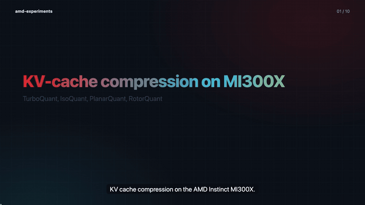
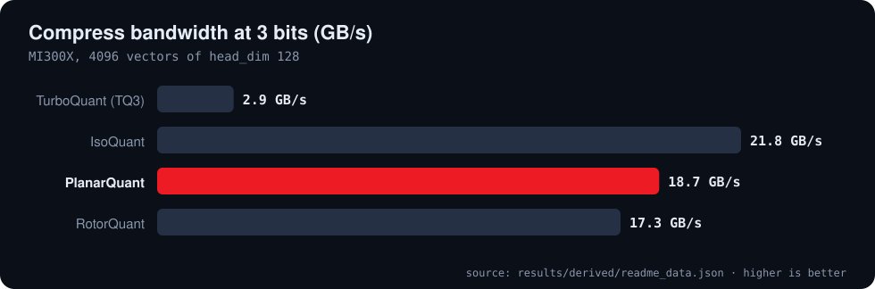
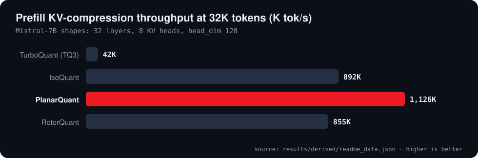
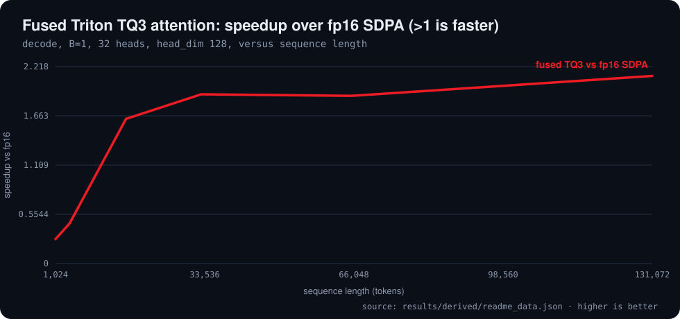
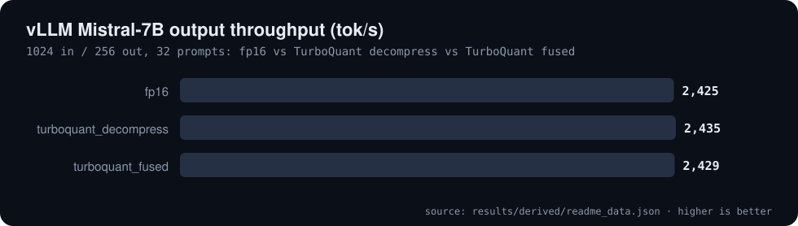
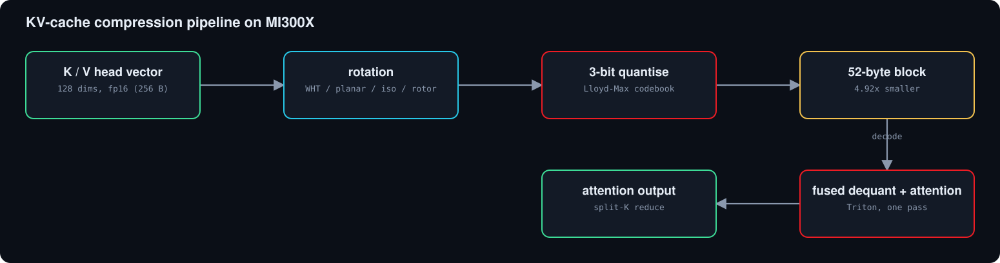
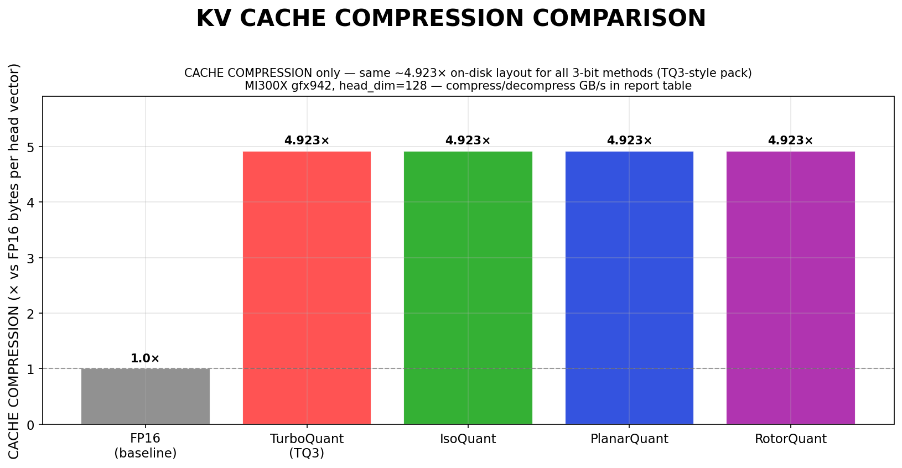

<div align="center">



# 🔥 amd-experiments

**KV-cache compression on AMD Instinct MI300X: TurboQuant, IsoQuant, PlanarQuant and RotorQuant with Triton/ROCm kernels**

    [](https://github.com/Bobliuuu/amd-experiments/releases/tag/v0.1.0) [](https://huggingface.co/datasets/Bobliu/amd-experiments) 

[🎬 Video](#video) · [📊 Results](#results) · [🧩 How it works](#how-it-works) · [🚀 Quick start](#quick-start) · [⚠️ Limitations](#caveats) · [🗺️ Repo map](#repo-map)

</div>

---

**Explainer video (voice-over and subtitles): what was compared, what is faster, and where the gain stops**

[](video/amd_experiments_explainer.mp4)

<a id="video"></a>
A four-way benchmark of **TurboQuant**, **IsoQuant**, **PlanarQuant** and **RotorQuant** KV-cache compression on an **AMD Instinct MI300X** (gfx942, 192 GB HBM3),
with Triton/ROCm and HIP kernels, Mistral-7B-v0.1 shapes, compress/decompress bandwidth, prefill overhead, fused-attention decode and KV reconstruction quality.

All four 3-bit methods share the same 52-byte block layout, so they compress identically (**4.92x** versus fp16) and reconstruct with the same cosine similarity (about 0.983).
They differ in **how fast they run**: the rotation is the cost. PlanarQuant uses 256 FMAs per vector, TurboQuant 16,384.

> **Honest bottom line.** The compression itself is cheap and accurate, and a fused Triton TQ3 attention kernel beats fp16 SDPA at long context (1.91x at 32K, B=1),
> but in vLLM serving of Mistral-7B **end-to-end output tokens per second do not change** (2,425 to 2,435 tok/s for fp16, TQ decompress and TQ fused), because weights and MLP dominate the decode step.

<a id="results"></a>

## 📊 Results

MI300X VF (gfx942), Mistral-7B-v0.1 shapes. All numbers are read from `results/*.json` by `tools/readme_data.py`.

**Four methods at 3 bits on MI300X (4096 vectors, head_dim 128; prefill at 32K tokens)**

| method | compression | FMAs / vector | compress GB/s | decompress GB/s | prefill K tok/s | cosine (3-bit) | cosine (4-bit) |
| :--- | ---: | ---: | ---: | ---: | ---: | ---: | ---: |
| TurboQuant (TQ3) | 4.92x | 16,384 | 2.9 | 4.4 | 42 | 0.9831 | 0.9954 |
| IsoQuant | 4.92x | 512 | 21.8 | 38.3 | 892 | 0.9828 | 0.9954 |
| **PlanarQuant** | **4.92x** | **256** | **18.7** | **35.4** | **1,126** | **0.9830** | **0.9954** |
| RotorQuant | 4.92x | 1,176 | 17.3 | 34.8 | 855 | 0.9833 | 0.9954 |

<sub>Source: `results/derived/readme_data.json`</sub>

<p align="center"></p>

<p align="center"></p>

The four 3-bit methods share an identical 52-byte block layout, so compression (4.92x) and reconstruction quality (cosine about 0.983) match; what differs is speed.
**PlanarQuant** is the recommended method: fewest FMAs (256 per vector against 16,384 for TurboQuant) and the fastest prefill compression (26.5x faster than TurboQuant).
IsoQuant has the highest pack bandwidth (21.8 GB/s); RotorQuant is not competitive with Iso or Planar on this hardware.

<a id="attention"></a>

## ⚡ Attention and serving

What the compressed cache buys at decode time.

<p align="center">1 is faster)" width="100%"></p>

<p align="center"></p>

The fused Triton TQ3 kernel is 0.28x of fp16 SDPA at 1K tokens and 1.91x at 32K (up to 2.11x). In a GQA fused-decode sweep it is 6.3x to 7.5x faster than decompress then SDPA.
In vLLM serving on Mistral-7B, output throughput is flat across fp16, TurboQuant decompress and TurboQuant fused (2,425 to 2,435 tok/s): the KV format does not unlock end-to-end decode when weights, the MLP and the framework dominate.
Details and the closure analysis: [docs/repo_decode_bottleneck_closure.md](docs/repo_decode_bottleneck_closure.md), [report/final_report_v2.md](report/final_report_v2.md).

<a id="how-it-works"></a>

## 🧩 How it works

Each K or V head vector (128 dims) is rotated, quantised to 3 bits and packed into a 52-byte block, **4.92x** smaller than fp16. The four methods differ only in the rotation:
TurboQuant's Walsh-Hadamard transform is the most expensive; PlanarQuant (2D Givens), IsoQuant (quaternion) and RotorQuant (Clifford rotor) are block rotations that are far cheaper.
Kernels: Triton/ROCm in `kernels/`, standalone HIP in `kernels/hip/` (9-test validation suite), MFMA-backed rotation, and a fused dequant-attention Triton kernel.

<p align="center"></p>

<p align="center"></p>

<a id="quick-start"></a>

## 🚀 Quick start

Use the locked benchmark interpreter for GPU work (`docs/benchmark_mi300_locked_env.md`).

```bash
python3 benchmarks/bench_compress_decompress.py --n-vectors 4096 --n-iters 50   # ~30 s
python3 benchmarks/bench_prefill.py --model mistralai/Mistral-7B-v0.1
python3 benchmarks/bench_batch_decode_v2.py --model mistralai/Mistral-7B-v0.1
python3 report/generate_figures_v2.py                                            # regenerate report figures
bash run_all_benchmarks.sh mistralai/Mistral-7B-v0.1                             # full suite, 60-90 min
python3 tools/readme_data.py && python3 ~/video-readme-maker/vrm.py all README.spec.yml   # this README and video
```
HIP kernels: `cd kernels/hip && bash build_mi300x.sh` (build and run inside the ROCm 7.2 Primus container, see `docker_run_amd_mi300x.sh`).
The complete previous README (benchmark catalogue, SWA mode, ABI notes, reading order) is kept in [docs/ORIGINAL_README.md](docs/ORIGINAL_README.md).

<a id="caveats"></a>

## ⚠️ Honest caveats

- **One GPU model, one model family.** Everything is MI300X (gfx942) with Mistral-7B-v0.1 shapes.
- **NIAH is synthetic** (100% pass on every 3-bit method) and perplexity runs use small windows.
- **Serving is one configuration** (1024 in / 256 out, 32 prompts). Flat end-to-end throughput does not mean KV compression is useless at larger batch or longer context.
- **Fused-kernel gains depend on context length**: at 4K tokens and below the fused TQ3 kernel is slower than fp16 SDPA.
- **HIP kernels cannot be loaded via ctypes in the PyTorch process** (ROCm code-object ABI mismatch); standalone binaries are used instead.

<a id="repo-map"></a>

## 🗺️ Repo map

| Path | What it is |
|---|---|
| `kernels/` | Triton kernels, HIP/C++ implementation, MFMA loaders, reference implementations |
| `benchmarks/` | all benchmark scripts |
| `baselines/` | FP16 / FP8 / INT4 end-to-end decode baselines |
| `results/` | JSON outputs from all benchmark runs; results/derived is produced by tools/readme_data.py |
| `report/` | final_report_v2.md, figures and the figure generator |
| `docs/` | locked environment, closure analysis, previous README |
| `tq_backends/` | drop-in TurboQuant / IsoQuant attention modules for vLLM |
| `tools/readme_data.py` | derives README and video numbers from results/ |
| `README.spec.yml` | spec for video-readme-maker |
| `video/` | explainer mp4, srt, poster, preview gif (generated) |

---

<div align="center"><sub>Generated with video-readme-maker from README.spec.yml and results/.</sub></div>
